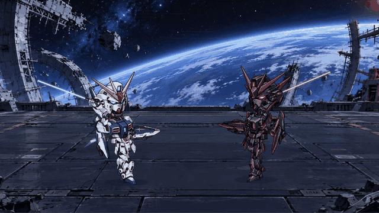
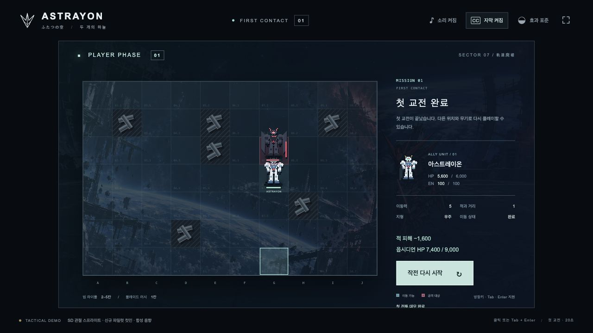
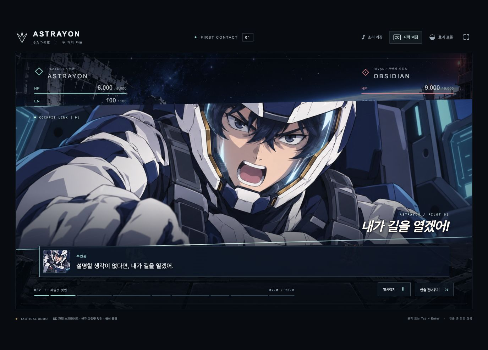

# ASTRAYON — 두 개의 하늘

**도트 기체를 움직여 사선을 만들고, 직접 선택한 공격을 20초의 메카 전투로 이어가는 브라우저 게임.**

ASTRAYON은 전술 격자와 SD 기체의 시네마틱 전투를 연결한 첫 교전 데모입니다. 아스트레이온과 옵시디언, 두 기체가 붕괴한 궤도도시에서 맞섭니다. 플레이어는 이동 위치와 무기를 선택하며, 전투가 끝난 뒤에는 위치와 HP·EN이 반영된 맵으로 돌아옵니다.

슈퍼로봇대전의 전술 맵 → 커맨드 → 전투 연출 흐름에서 착안했습니다. 맵 도트, 기체 부품, 파일럿 컷인과 음향은 이 프로젝트용으로 제작했으며, 공식 게임이나 공식 배포물이 아닙니다.



*실제 프로덕션 렌더러에서 캡처한 12.70–16.70초 구간입니다. 검을 휘두르는 동작부터 피격과 무릎 붕괴까지 49개 프레임으로 구성했습니다.*

| 전술 맵으로 결과 복귀 | 조종석 액션 컷인 |
|---|---|
|  |  |

## 직접 플레이하기

Node.js 22와 npm을 사용합니다. 저장소에 `node_modules/`, `.next/`, `out/` 빌드 결과는 포함하지 않으므로, 처음에는 의존성 설치가 필요합니다.

```sh
git clone https://github.com/ReentaKim/astrayon-first-contact.git
cd astrayon-first-contact/web
npm ci
npm run dev -- --port 3001
```

[개발 게임 열기](http://127.0.0.1:3001/)

검증한 프로덕션 구성으로 실행하려면 `web/`에서 다음 명령을 사용합니다.

```sh
npm run build
npm run preview
```

[프로덕션 게임 열기](http://127.0.0.1:4173/) · [모션 검수 화면](http://127.0.0.1:4173/review)

터미널의 `Control+C`로 종료합니다. 포트가 사용 중이면 `PORT=4174 npm run preview`로 변경할 수 있습니다. `out/index.html`을 파일로 직접 여는 대신 제공된 로컬 서버를 사용하세요. macOS의 [`web/start.command`](web/start.command)도 **설치와 빌드가 완료된 뒤** 사용할 수 있습니다.

## 첫 교전

1. **작전 개시** 후 흰색 아스트레이온 또는 **이동**을 선택합니다.
2. 푸른 칸으로 이동합니다. 이동력은 상하좌우 5칸이며 잔해와 적 기체를 통과하지 못합니다.
3. **공격** 또는 적 기체를 선택하고, 사거리에 맞는 무기를 확정합니다.
4. 파일럿 컷인, 무장 준비, 공격, 충돌, 피격과 결과가 약 20초 동안 이어집니다.
5. **전술 맵에서 결과 확인**으로 돌아오거나 다른 선택으로 다시 플레이합니다.

좌표는 왼쪽 위가 **1열 1행**입니다. 초기 아군은 **3열 5행**, 적은 **7열 3행**에 있습니다.

| 무기 | 추천 이동 칸 | 사거리 | 교전 결과 |
|---|---|---|---|
| 빔 라이플 | 5열 4행 | 2–5칸 | 적 HP 7,800 · 아군 HP 6,000 · EN 80 · 조준 +1 |
| 블레이드 러시 | 7열 4행 | 인접 1칸 | 적 HP 7,400 · 아군 HP 5,600 · EN 100 |

이동은 공격 확정 전에 취소할 수 있습니다. 연출 중 명령은 잠기며, 스킵해도 피해나 자원 소모가 중복 적용되지 않습니다. 키보드 조작·음소거·자막·효과 줄임·일시정지·재시작을 지원합니다. 자세한 조작은 [웹 앱 안내](web/README.md)에 있습니다.

## 전투를 만드는 방식

- **SD 관절 기체:** 기체별 16개 투명 부품을 목·어깨·팔꿈치·손·허리·고관절·무릎으로 연결합니다. 부품별 실제 접합점과 무기 손잡이를 사용합니다.
- **전신 검격:** 하체 하중 축적 → 골반 회전 → 가슴과 어깨 → 팔꿈치와 손목 순으로 움직임을 이어 갑니다. 검격 후에는 잔여 회전이 남습니다.
- **피격 반응:** 충격에 따른 밀림, 상체 반동, 무릎 붕괴와 자세 회복을 분리하고 발바닥 접지를 보정합니다.
- **연출 동기화:** 준비·접촉·반동, 총구·검끝의 효과, 음향과 컷인이 하나의 전투 시간에 맞춰 재생됩니다.
- **상태 분리:** 전투 결과는 순수 상태 전이에서 한 번만 확정합니다. 렌더러의 탐색·일시정지·스킵이 게임 수치를 다시 계산하지 않습니다.

Next.js 16.4.1 · React 19.3.1 · TypeScript · PixiJS 8.22.0 · GSAP 3.15.0 · Web Audio API. 의존성은 [`package-lock.json`](web/package-lock.json)에 고정되어 있습니다.

## 검증

2026-10-16 기준으로 다음을 확인했습니다.

| 항목 | 결과 |
|---|---|
| `npm run typecheck` | 통과 |
| `npm test` | **33개 통과** |
| `npm run build` | 정적 빌드 통과 |
| 실제 브라우저 플레이 | 두 무기 모두 **20.00초 자연 종료**, 결과 수치 확인 |
| 맵과 전투 연결 | 이동·사거리·공격·결과·맵 복귀 확인 |
| 모션 검수 | 접합, 접촉, 전신 동작, 피격, 효과 줄임과 탐색 확인 |

```sh
cd web
npm run typecheck
npm test
npm run build
```

[상세 검증 기록과 미검증 범위](web/QA.md) · [전신 동작 비교 화면](web/qa/motion-v4/motion-contact-sheet.jpg)

브라우저 검사는 데스크톱 환경에서 수행했습니다. 실제 모바일 기기, 모든 브라우저, 장시간 성능, 스피커 청취 및 최종 음향 믹싱까지 검증했다는 뜻은 아닙니다.

## 현재 범위와 소재 상태

현재 플레이 범위는 **맵 한 장, 아군과 적 각 한 기, 첫 공격 두 경로**입니다. 적 턴 AI, 반복 교전, 캠페인, 3분 전체 시나리오와 후속 방어·회피·최종 공격은 아직 구현하지 않았습니다.

| 구분 | 현재 상태 |
|---|---|
| SD 기체 32개 부품, 조종석 컷인 2장, 전장 배경 | 새로 생성·가공해 실제 게임에 적용 |
| 맵 도트·관절 동작·빔·검광·추진 효과 | 코드로 제작해 실제 사용 |
| 이전 풀 사이즈 원화와 레퍼런스 크롭 | 제작 과정 비교 자료로 보존, 현재 전투 기체·파일럿 컷인에서는 교체 완료 |
| 기체의 시점 전환·원근 변화·연결 작화 | 추가 제작 필요 |
| 파일럿 눈·입·표정 프레임 | 추가 제작 필요 |
| 음악·효과음 | 데모용 합성 음향, 최종 제작·믹싱 필요 |
| 성우 음성 | 미제작 |

현재 전투는 **분리한 래스터 원화를 연결하는 관절 애니메이션**입니다. 매 프레임 손으로 새로 그린 최종 애니메이션과 구분합니다. [소재 상태와 교체 목록](web/ASSET_REPLACEMENTS.md), [SD 원본·생성 프롬프트](web/source-art/sd-v3/)를 함께 보존합니다.

## 저장소 구성과 개발 기록

```text
assets/references/       초기 설정화 원본과 참고 자료
docs/                   제작 방향, 아트·구현 기준, 개발 기록
web/src/components/     전술 맵, 커맨드, HUD, 파일럿 컷인
web/src/game/state/     이동·사거리·자원·전투 결과
web/src/game/scenes/    Pixi 전장과 SD 관절 리그
web/src/game/data/      접합점, 동작 키, 쇼트·대사
web/src/game/timeline/  단일 전투 시간과 재생 제어
web/src/game/audio/     합성 음향과 오디오 제어
web/public/game/        실제 런타임 소재
web/source-art/         생성 원본과 이전 제작 소재
web/tests/              상태·이동·모션·오디오 회귀 테스트
web/qa/                 실제 실행 캡처와 검증 자료
```

[개발 과정 기록](docs/07-DEVELOPMENT-JOURNAL.md)에 초기 인계 → 플레이 루프 → SD 재설계 → 접합 교정 → 전신 동작 개선 과정을 정리합니다. `docs/01`–`05`는 초기 제작 제안을 담고 있으므로, 현재 구현 범위는 이 README와 최신 QA 기록을 기준으로 봅니다.

**커밋 이력은 보존한 산출물을 기능 단위로 정리한 기록입니다.** 과거 단계별 소스 스냅샷이 모두 남아 있지 않아, 각 커밋을 당시의 실행 버전으로 복원했다는 의미는 아닙니다. 존재하지 않는 중간 버전이나 개발 시각을 만들어 이력을 재현하지 않습니다.

제작·관리: [ReentaKim](https://github.com/ReentaKim)
