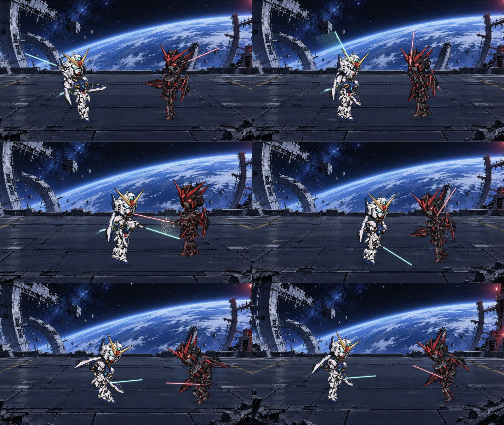

# ASTRAYON 웹 앱

도트 기체의 격자 이동, 무기 선택, SD 기체의 20초 전투, 결과를 유지한 맵 복귀를 구현한 첫 교전 데모입니다. 프로젝트 소개와 개발 배경은 [저장소 README](../README.md), 검증 증거는 [QA.md](QA.md)에 있습니다.


*12.70–16.70초의 실제 렌더러 프레임을 연결한 미리보기입니다.*

## 설치와 실행

Node.js 22와 npm에서 검증했습니다. 아래 명령은 **저장소의 `web/` 폴더**에서 실행합니다.

```sh
npm ci
npm run dev -- --port 3001
```

[개발 게임](http://127.0.0.1:3001/) · [개발 모션 검수](http://127.0.0.1:3001/review)

프로덕션 정적 빌드:

```sh
npm run build
npm run preview
```

[프로덕션 게임](http://127.0.0.1:4173/) · [프로덕션 모션 검수](http://127.0.0.1:4173/review)

`node_modules/`, `.next/`, `out/`는 저장소에 포함되지 않습니다. 새로 복제한 저장소에서는 반드시 `npm ci`와 `npm run build`를 먼저 실행한 뒤 `preview` 또는 [`start.command`](start.command)를 사용하세요. 로컬 서버는 `127.0.0.1`에 열리며 `Control+C`로 종료합니다. `PORT=4174 npm run preview`로 포트를 변경할 수 있습니다. `out/index.html`을 파일로 직접 여는 방식은 지원하지 않습니다.

| 명령 | 용도 |
|---|---|
| `npm run dev -- --port 3001` | 소스 수정용 개발 서버 |
| `npm run typecheck` | TypeScript 검사 |
| `npm test` | 상태·이동·관절·모션·오디오 회귀 검사 |
| `npm run build` | Next.js 정적 출력 생성 |
| `npm run preview` | `out/`를 제공하는 로컬 서버 |
| `npm run art:sd` | 보존된 SD 원본을 런타임 부품으로 가공 |
| `npm run art` | 이전 v2 원화를 가공 |
| `npm run assets:legacy` | 초기 SVG 애니매틱 보관본 재생성 |

## 플레이와 조작

1. **작전 개시** → 아스트레이온 또는 **이동**을 선택합니다.
2. 푸른 칸으로 이동합니다. 이동력은 상하좌우 5칸이며 잔해와 적 기체는 통과하지 않습니다.
3. **공격** 또는 적 기체를 선택해 무기를 확정합니다.
4. 컷인 → 준비 → 공격 → 충돌 → 피격 → 결과가 약 20초간 재생됩니다.
5. **전술 맵에서 결과 확인**으로 복귀하거나 다시 플레이합니다.


좌표는 왼쪽 위를 1열 1행으로 셉니다. 초기 아스트레이온은 **3열 5행**, 옵시디언은 **7열 3행**입니다.

| 무기 | 추천 이동 칸 | 사거리 | 피해·자원 | 종료 상태 |
|---|---|---|---|---|
| 빔 라이플 | 5열 4행 | 2–5칸 | 적 피해 1,200 / EN −20 / 조준 +1 | 아군 HP 6,000 · EN 80 / 적 HP 7,800 |
| 블레이드 러시 | 7열 4행 | 인접 1칸 | 적 피해 1,600 / 아군 반격 피해 400 | 아군 HP 5,600 · EN 100 / 적 HP 7,400 |

이동은 공격 확정 전에 취소할 수 있습니다. 공격 중 명령 입력은 잠기며, 스킵은 이미 확정한 결과로 이동합니다.

| 입력 | 동작 |
|---|---|
| Tab / Enter | 버튼 탐색과 실행 |
| 격자 안의 방향키 | 칸 탐색 |
| 무기 선택에서 1 / 2 | 라이플 / 러시 선택, 사거리 검증 적용 |
| 전투 중 P / Escape | 일시정지 |
| 전투 중 Space | 입력 요소 밖에서 일시정지 |
| 전투 중 S | 연출 건너뛰기 |
| 일시정지 중 Escape | 재개 |
| 결과에서 R | 다시 시작 |
| M | 음소거 |

상단 버튼으로 소리, 자막, 효과 줄임, 전체 화면을 조절합니다. 탭이 숨겨지면 자동으로 일시정지하며 복귀 후 사용자가 재개합니다.

## 전신 모션과 접촉

각 기체는 **16개 투명 부품**으로 구성됩니다. 부품별 실제 회전축과 연결점을 측정해 목·어깨·팔꿈치·손·허리·고관절·무릎을 연결하고, 손잡이·총구·검끝을 효과 좌표와 연동합니다. 생성 원화의 앞·뒷팔과 두 기체가 다른 형태이므로 부품마다 별도의 좌표를 사용합니다.

검격은 하체에 힘을 모은 뒤 골반, 가슴과 어깨, 팔꿈치와 손목 순으로 이어집니다. 피격은 밀림, 상체 반동, 무릎 붕괴, 자세 회복을 나누어 표현합니다. 접촉 시 잠시 동작을 유지하고 발바닥 접지를 보정하며, 효과 줄임에서는 카메라와 충격 효과를 줄입니다.



전투 상태와 연출은 분리되어 있습니다. `COMMIT`에서 자원·피해를 한 번 확정하고, 액션 ID와 세션 ID로 오래된 완료 콜백과 중복 입력을 거릅니다. 타임라인과 오디오는 일시정지·스킵·재시작 때 함께 관리됩니다.

## 모션 검수 화면

`/review`는 본편과 같은 `BattleStage`를 사용합니다.

- 0.5× / 1× 재생과 일시정지
- 슬라이더, 정확한 시간 입력, ±1/60초 프레임 탐색
- 준비·추진·패링·회전·본 접촉·피격·무릎 붕괴·복귀 프리셋
- 효과 표준 / 줄임 비교

숫자 입력은 Enter 또는 포커스를 옮기면 적용됩니다. 시점 탐색과 무기 변경은 재생을 멈춥니다. 접촉 검수의 핵심 시각은 러시 기준 **6.62초 / 13.50초 / 14.55초**입니다. 이 화면에는 파일럿, HUD, 음향과 실제 플레이 상태가 없으므로 본편 검수를 대신하지 않습니다.

## 코드와 소재 위치

| 위치 | 역할 |
|---|---|
| `src/components/BattleGame.tsx` | 커맨드·컷인·HUD·접근성·장면 연결 |
| `src/components/TacticalMap.tsx` | 도트 기체·이동 경로·맵 조작 |
| `src/game/state/` | 순수 전투 상태, BFS 이동, 보간·사거리·자원 검증 |
| `src/game/scenes/BattleStage.ts` | Pixi 전장·빔·부스터·검광·접촉 효과 |
| `src/game/scenes/SDMechaRig.ts` | 16파트 관절 계층과 손·무기·발바닥 소켓 |
| `src/game/data/rig-layout.ts` | 부품별 접합점과 비례 |
| `src/game/data/motion.ts` | 두 공격의 전신 자세, 보간, 접촉 정지와 음향 시점 |
| `src/game/data/shots.ts` | 9개 쇼트 구간과 대사 |
| `src/game/timeline/AttackDirector.ts` | GSAP 20초 전투 시간, 정지·스킵·해제 |
| `src/game/audio/BattleAudio.ts` | Web Audio 합성 배경음·효과음·음량 제어 |
| `public/game/sd/` | SD 부품 32개, 파일럿 액션 원화 2장, 전장 배경 |
| `source-art/sd-v3/` | 생성 원본 5장과 정확한 프롬프트 |
| `tests/` | 상태·전술·모션·오디오·타임라인 회귀 검사 |
| `qa/motion-v4/` | 최신 전신 모션 검수 캡처·수치·GIF |

Next.js 16.4.1 / React 19.3.1 / PixiJS 8.22.0 / GSAP 3.15.0을 사용하며, 설치 버전은 `package-lock.json`에 고정되어 있습니다.

## 실제 제작된 것과 남은 작업

현재 런타임의 기체는 신규 SD 부품을 연결한 **관절 애니메이션**입니다. 이전 통짜 기체 포즈와 단일 충돌 원화는 현재 전투에서 사용하지 않습니다. 파일럿도 레퍼런스 크롭에서 전용 조종석 액션 원화로 교체했습니다. 맵 도트는 직접 작성한 픽셀 배열이고, 빔·검광·추진 효과는 코드로 렌더링합니다.

다음은 아직 별도 제작이 필요합니다.

- 파일럿의 눈·입·표정 프레임
- 기체의 뒤돌기·다른 시점·원근 변화·검격 연결 작화
- 생성 부품 표면 디테일과 최종 모델 시트 검수
- 데모용 합성 음향의 최종 음악·효과음·믹싱, 선택적 성우 녹음

`source-art/`와 `public/game/art/`에는 이전 단계의 산출물을 비교용으로 보존합니다. 이전 궤도 배경은 맵과 예비 배경에 사용하며, 초기 파일럿 크롭과 SVG 기체는 현재 전투 소재와 구분합니다. [ASSET_REPLACEMENTS.md](ASSET_REPLACEMENTS.md)에 실제 파일과 교체 범위를 정리했습니다.

플레이는 맵 한 장, 아군·적 각 한 기, 첫 공격 두 경로까지입니다. 적 턴 AI, 반복 교전, 캠페인, 후속 방어·회피·최종 공격은 아직 없습니다.

## 검증과 개발 이력

2026-10-16 기준 **타입 검사·33개 테스트·프로덕션 빌드가 통과**했습니다. 실제 브라우저에서 러시와 라이플이 각각 **20.00초에 자연 종료**하고 위 표의 HP·EN으로 반영되는 것을 확인했습니다. 이동·사거리·공격·맵 복귀, 관절 접합과 무기 접촉, 재생·탐색·효과 줄임도 검수했습니다.

[최신 QA 기록](QA.md) · [개발 과정](../docs/07-DEVELOPMENT-JOURNAL.md) · [SD 동작 제작 방향](../docs/06-SD-MOTION-DIRECTION.md)

실제 모바일 기기, 모든 브라우저, 장시간 성능, 스피커 청취와 최종 음향 믹싱은 이번 검증 범위에 포함하지 않습니다.

커밋은 보존된 설계·에셋·현재 코드·검수 자료를 기능 단위로 정리한 기록입니다. 과거 단계별 소스 스냅샷이 모두 남아 있지 않아, 시간순으로 당시 실행 버전을 복원한 이력은 아닙니다.
